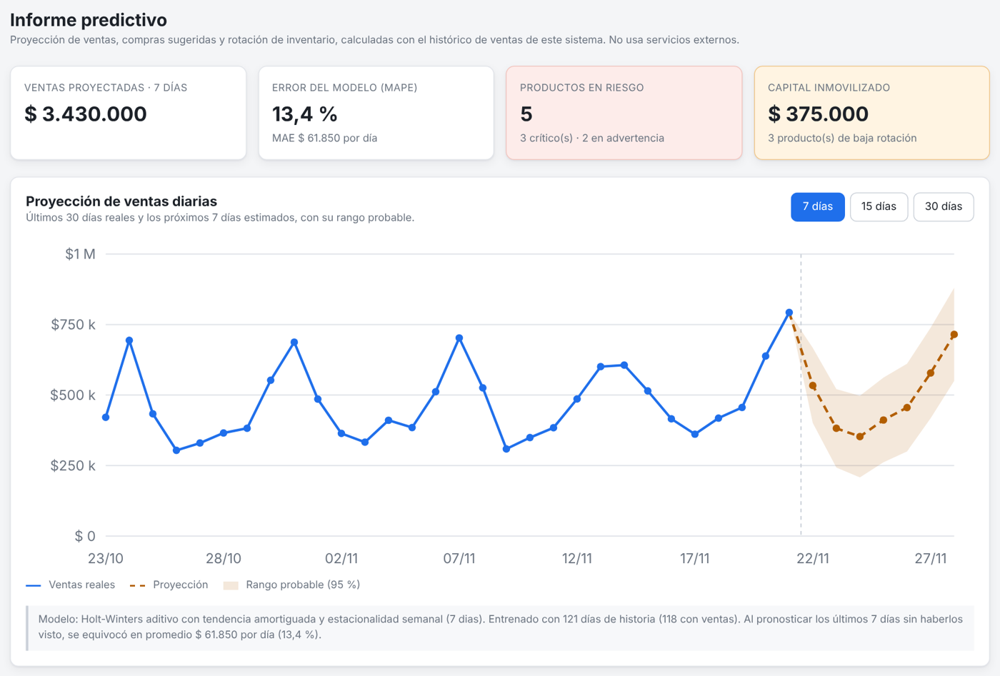
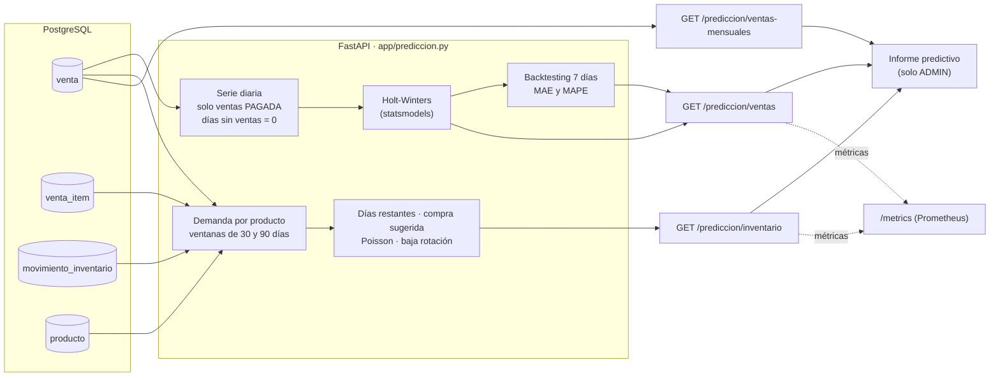
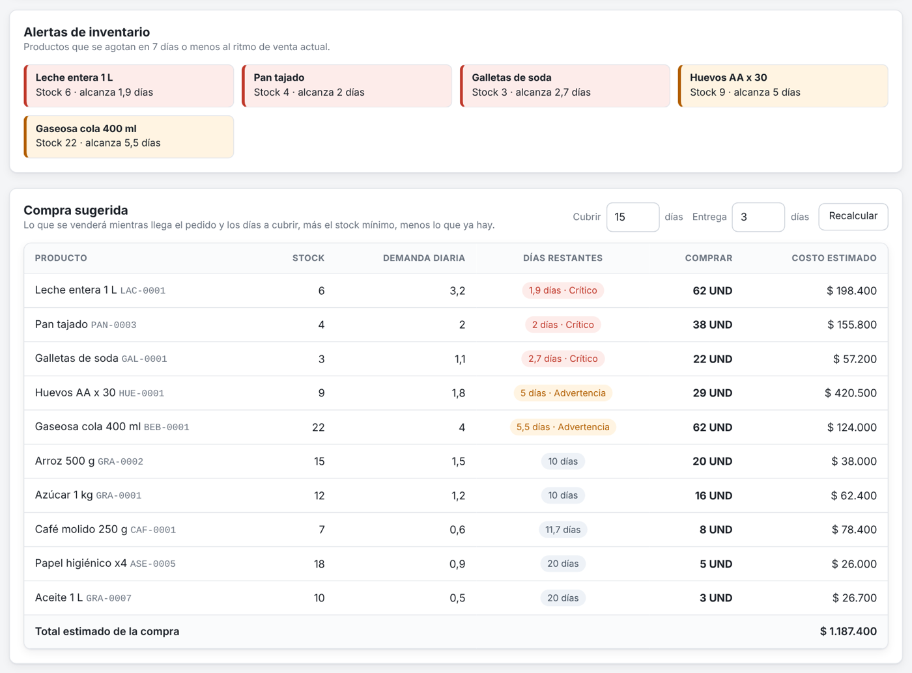

# Módulo de IA predictiva

El **Informe predictivo** le muestra al administrador qué va a vender en los próximos días, qué productos se van a agotar, cuánto comprar y qué mercancía está quieta. Todo se calcula dentro del sistema con el histórico de ventas de la propia base de datos: no llama a servicios externos, no usa IA generativa y funciona sin internet.

- **Quién lo ve:** solo el rol ADMIN (menú *Informe predictivo*). El CAJERO recibe `403` en la API y no ve la opción en el menú.
- **Código:** `backend/app/prediccion.py` (cálculos), `backend/app/routers/prediccion.py` (endpoints y métricas), `backend/app/schemas/prediccion.py` (respuestas) y `frontend/src/pages/InformePredictivo.jsx` (pantalla).
- **Historias:** HU-25 (motor predictivo), HU-26 (informe y métricas) y HU-27 (esta documentación).

## Contenido

1. [Problema que resuelve](#1-problema-que-resuelve)
2. [Por qué IA predictiva y no generativa](#2-por-qué-ia-predictiva-y-no-generativa)
3. [Cómo funciona por dentro](#3-cómo-funciona-por-dentro)
4. [Datos que usa](#4-datos-que-usa)
5. [Proyección de ventas: Holt-Winters](#5-proyección-de-ventas-holt-winters)
6. [Inventario: días restantes, compra sugerida y Poisson](#6-inventario-días-restantes-compra-sugerida-y-poisson)
7. [Evaluación del modelo](#7-evaluación-del-modelo)
8. [Limitaciones y mejoras posibles](#8-limitaciones-y-mejoras-posibles)
9. [Endpoints y cómo probarlo](#9-endpoints-y-cómo-probarlo)

> Las capturas de este documento se tomaron con **datos de demostración** para que se vean todas las secciones. Con los datos semilla (`database/seed.sql`) la proyección dice que faltan días con ventas, porque la semilla trae menos de 14.

---

## 1. Problema que resuelve

Un negocio pequeño pierde dinero de tres formas que el inventario por sí solo no muestra:

| Problema | Qué pasa sin el módulo | Qué responde el informe |
| --- | --- | --- |
| **Quiebres de stock** | El producto se acaba y se pierden ventas hasta que llega el pedido. | Cuántos días alcanza el stock de cada producto al ritmo de venta actual, con alerta **crítica** (3 días o menos) o de **advertencia** (7 días o menos). |
| **Capital inmovilizado** | Se compra mercancía que no rota y la plata queda parada en el estante. | Qué productos tienen baja probabilidad de venderse en 30 días y cuánto dinero (al costo) hay en ellos. |
| **Planeación de compras** | Se compra "a ojo": de más en lo que no se vende y de menos en lo que sí. | Cuántas unidades pedir de cada producto según la demanda, los días que se quieren cubrir y lo que tarda el proveedor. |
| **Flujo de caja** | No se sabe cuánto va a entrar en la semana. | Cuánto se espera vender en los próximos 7, 15 o 30 días, con un rango probable. |



## 2. Por qué IA predictiva y no generativa

Las preguntas del informe son numéricas ("¿cuántas unidades?", "¿cuánto voy a vender?"). Para eso sirven los modelos estadísticos de series de tiempo y de conteo, no un modelo de lenguaje.

| Criterio | IA predictiva (lo que usamos) | IA generativa (un LLM por API) |
| --- | --- | --- |
| Tipo de respuesta | Números con una fórmula detrás | Texto; puede inventar cifras |
| Mismo dato, misma respuesta | Sí, es determinista | No necesariamente |
| Error medible | Sí: MAE y MAPE con backtesting | Difícil de medir |
| Funciona sin internet | Sí, corre dentro de la API | No: depende de un proveedor externo |
| Costo por consulta | Ninguno | Se paga por uso |
| Datos del negocio | No salen del servidor | Se envían a un tercero |
| Explicable al administrador | Sí: cada valor tiene su fórmula (sección 6) | Poco |

### ¿Por qué no árboles de decisión, Random Forest o redes neuronales?

Se evaluaron, pero no encajan con el tamaño ni la forma de los datos:

- **Hay una sola serie y es corta.** Un negocio que empieza tiene semanas o pocos meses de ventas. Random Forest o XGBoost necesitan muchas filas y variables (clima, festivos, promociones) que el sistema no guarda. Con pocos datos memorizan la historia y pronostican mal.
- **Los árboles no extrapolan.** Un árbol solo puede devolver valores que ya vio; si las ventas vienen subiendo, nunca proyecta un valor más alto que el máximo histórico.
- **Holt-Winters está hecho para esto:** una serie diaria con nivel, tendencia y un patrón semanal. Tiene 4 parámetros, se ajusta en milisegundos y no hace falta guardar ni versionar un archivo de modelo.
- **Para el inventario no hace falta "entrenar":** con la demanda de cada producto, fórmulas de inventario y una distribución de Poisson se obtienen resultados exactos y explicables.

## 3. Cómo funciona por dentro



- **Se calcula en cada consulta.** No hay tareas programadas ni modelos guardados: cada vez que el administrador abre el informe, el modelo se vuelve a ajustar con las ventas hasta ayer. Con un año de historia tarda milisegundos.
- **Las funciones de cálculo están separadas de las consultas a la base** (sección "Funciones puras" del archivo), para probarlas con datos sintéticos sin base de datos.

## 4. Datos que usa

### Tablas

| Tabla | Para qué |
| --- | --- |
| `venta` | Fecha, total y estado de cada venta: arma la serie diaria y el total mensual. |
| `venta_item` | Unidades vendidas por producto: demanda de 30 y 90 días y fecha de la última venta. |
| `movimiento_inventario` | Fecha de la última entrada por compra (`tipo = 'COMPRA'`), para no marcar como "baja rotación" mercancía recién comprada. |
| `producto` | Stock actual, stock mínimo, costo, unidad y fecha de creación. |

### Filtros

- **Solo ventas `PAGADA`.** Las anuladas no cuentan: esa venta no ocurrió.
- **Solo productos activos.** Un producto desactivado no se vuelve a comprar.
- **Fechas en hora de Colombia** (`America/Bogota`). Una venta a las 11 p. m. cuenta en ese día y no en el siguiente, como pasaría con la fecha en UTC.
- **El día de hoy no entra en la serie.** El día no ha terminado; su total parcial haría creer al modelo que las ventas cayeron.

### Preparación

| Paso | Detalle |
| --- | --- |
| Agregación diaria | Suma de `venta.total` por fecha local. |
| Días sin ventas | Se rellenan con 0 (`completar_serie`). Si se omitieran, el modelo creería que se vende todos los días. |
| Largo de la serie | Desde la primera venta hasta ayer, con un máximo de 365 días. |
| Gráfico | Muestra los últimos 30 días reales y los días proyectados. |
| Ventana de 30 días | Unidades vendidas por producto en los últimos 30 días (incluido hoy): demanda diaria. |
| Ventana de 90 días | Unidades de los últimos 90 días: tasa de la distribución de Poisson. Es más larga porque los productos lentos venden muy poco en 30 días. |

## 5. Proyección de ventas: Holt-Winters

Holt-Winters es **suavizamiento exponencial**: cada valor nuevo se combina con lo que el modelo ya sabía, y los días recientes pesan más que los antiguos. Separa la serie en tres partes:

- **Nivel (ℓ):** cuánto se vende en un día "normal" ahora.
- **Tendencia (b):** si las ventas vienen subiendo o bajando. Es **amortiguada** (φ < 1): se aplana con el horizonte en vez de proyectar una recta infinita.
- **Estacionalidad (s):** cuánto se aparta cada día de la semana del nivel (por ejemplo, el sábado vende más que el martes). Es **aditiva** porque la serie puede tener días en 0.

Ecuaciones del modelo (estacionalidad semanal, m = 7):

```math
\begin{aligned}
\ell_t &= \alpha\,(y_t - s_{t-m}) + (1-\alpha)(\ell_{t-1} + \phi\, b_{t-1}) \\
b_t &= \beta\,(\ell_t - \ell_{t-1}) + (1-\beta)\,\phi\, b_{t-1} \\
s_t &= \gamma\,(y_t - \ell_{t-1} - \phi\, b_{t-1}) + (1-\gamma)\, s_{t-m} \\
\hat{y}_{t+h} &= \ell_t + (\phi + \phi^2 + \dots + \phi^h)\, b_t + s_{t+h-m}
\end{aligned}
```

### Cómo se entrena

- `statsmodels` (`ExponentialSmoothing`) estima α, β, γ y φ **minimizando el error cuadrático** entre lo que el modelo habría pronosticado cada día y lo que realmente se vendió.
- **Mínimo 14 días con ventas.** Con menos, la API responde `datos_suficientes: false` y no proyecta: no se inventan valores.
- **La estacionalidad semanal se activa desde 28 días** de historia (4 repeticiones de cada día de la semana). Con menos se usa tendencia amortiguada sin estacionalidad.
- **Respaldo:** si la optimización falla (serie muy corta o plana), se ajusta un suavizamiento simple sin tendencia ni estacionalidad.
- Los valores proyectados nunca bajan de 0.

### Rango probable (95 %)

Cada día proyectado trae un valor `inferior` y uno `superior`:

```math
\hat{y}_{t+h} \pm 1{,}96\;\sigma\,\sqrt{1 + (h-1)\,\alpha^2}
```

σ es la desviación de los residuos del ajuste (lo que el modelo se equivocó en la historia). La raíz hace que el rango se abra con el horizonte: el día 30 es más incierto que el día 1. Es una aproximación; si σ es grande (ventas muy irregulares), la banda también lo será.

## 6. Inventario: días restantes, compra sugerida y Poisson

| Resultado | Fórmula | Parámetros |
| --- | --- | --- |
| Demanda diaria | `unidades vendidas en 30 días / 30` | Ventana: 30 días |
| Días restantes | `stock actual / demanda diaria` (sin dato si no se vende) | — |
| Nivel de alerta | **crítico** si días ≤ 3 · **advertencia** si días ≤ 7 · **normal** si no | 3 y 7 días |
| Compra sugerida | `⌈demanda × (cobertura + entrega)⌉ + stock mínimo − stock actual` (mínimo 0) | Cobertura 15 días, entrega 3 días (editables en el informe) |
| Probabilidad de venta en 30 días | `1 − e^(−λ·30)`, con `λ = unidades en 90 días / 90` | Poisson, ventana de 90 días |
| Baja rotación | Tiene stock **y** (probabilidad < 20 % **o** más de 60 días sin venderse), salvo que haya entrado por compra hace 15 días o menos | 20 %, 60 y 15 días |
| Capital inmovilizado | `stock × costo` de los productos de baja rotación | — |

**¿Por qué Poisson?** Las ventas de un producto lento son eventos raros e independientes (alguien compra una cera de pisos cada tanto). La distribución de Poisson modela cuántas veces ocurre algo así en un periodo: si en promedio se esperan `λ·30` ventas en 30 días, la probabilidad de **cero** ventas es `e^(−λ·30)`, y la de **al menos una** es lo que falta para 1.

**Producto nunca vendido:** los días sin venta se cuentan desde que se creó el producto.

### Ejemplo con los datos de las capturas

- **Leche entera 1 L:** 96 unidades en 30 días → 3,2 por día. Stock 6 → 6 / 3,2 = **1,9 días → crítico**. Compra sugerida: ⌈3,2 × (15 + 3)⌉ = ⌈57,6⌉ = 58; + 10 de stock mínimo − 6 en stock = **62 unidades**.
- **Cera para pisos:** 1 unidad en 90 días → λ = 1/90; en 30 días se espera 1/3 de venta. P = 1 − e^(−0,333) = **28,3 %**. Supera el 20 %, pero lleva **74 días sin venderse** (más de 60), así que es de baja rotación: 14 × $9.000 = **$126.000 inmovilizados**.



## 7. Evaluación del modelo

### Backtesting de 7 días

Medir el error con los mismos datos de entrenamiento es engañoso: el modelo ya los "vio". Por eso:

1. Se entrena el modelo **sin los últimos 7 días**.
2. Se pronostican esos 7 días.
3. Se comparan con lo que realmente se vendió.

Requiere al menos 10 días de entrenamiento además de los 7 de prueba.

| Métrica | Fórmula | Qué dice |
| --- | --- | --- |
| **MAE** (error absoluto medio) | promedio de \|real − estimado\| | En cuántos pesos por día se equivoca el modelo. |
| **MAPE** (error porcentual medio) | promedio de \|real − estimado\| / real × 100 | El mismo error, como porcentaje de lo que se vendió cada día. Ignora los días con venta real en 0, porque no se puede dividir por cero. |

### Cómo interpretarlo

- **Compare el MAE con la venta promedio diaria.** Si se venden $450.000 al día y el MAE es $60.000, el modelo se equivoca alrededor de un 13 % en un día cualquiera.
- **El MAPE se dispara con los días flojos.** Divide por la venta real de cada día, así que un solo día con ventas muy bajas lo infla. Caso real observado en este proyecto: el MAE era $191.408 por día, pero el MAPE salía en **276 %**. Uno de los 7 días evaluados tuvo ventas de unos $40.000 cuando el modelo esperaba unos $500.000; solo ese día aporta un error de (500.000 − 40.000) / 40.000 ≈ 1.150 %. El modelo no estaba "roto": ese día fue atípico, o había ventas sin registrar. En casos así, guíese por el MAE.
- **Referencia orientativa** para ventas diarias de un comercio pequeño: un MAPE por debajo del 20 % es bueno; entre 20 % y 50 %, aceptable para planear; por encima, revise si hay días atípicos antes de desconfiar del modelo.
- **La banda del 95 %** es más útil que el valor central para decidir: planee con el valor inferior si quiere ser prudente con la caja.

### Métricas en Prometheus

`GET /metrics` publica, además de las métricas de la API:

| Métrica | Tipo | Etiquetas | Uso |
| --- | --- | --- | --- |
| `punto360_prediccion_calculos_total` | Counter | `tipo` (`ventas`, `inventario`, `mensual`), `resultado` (`ok`, `sin_datos`, `error`) | Cuántas veces se usa el informe y cuántas falla o no tiene datos. |
| `punto360_prediccion_duracion_segundos` | Histogram | `tipo` | Cuánto tarda cada cálculo. |
| `punto360_prediccion_mape` | Gauge | — | MAPE del último backtesting, para vigilar si el modelo empeora. |

## 8. Limitaciones y mejoras posibles

| Limitación | Efecto | Mejora posible |
| --- | --- | --- |
| **Poco historial** | Con menos de 14 días con ventas no hay proyección, y con menos de 28 no hay patrón semanal. | Ninguna técnica lo evita: hay que esperar a acumular datos. Mientras tanto el inventario sí funciona desde la primera venta. |
| **Sin estacionalidad anual** | Diciembre, temporada escolar o festivos no se anticipan; el modelo solo aprende el patrón de la semana. | Con 2 años de datos o más, agregar estacionalidad anual o un calendario de festivos colombianos como variable. |
| **Tiempo de entrega fijo** | Se usa el mismo valor para todos los proveedores (3 días, editable en el informe). | Guardar el tiempo de entrega de cada proveedor y usarlo por producto. |
| **Productos nuevos** | Sin historia de ventas, su demanda es 0: no generan alertas ni compra sugerida. Si tienen stock y no entraron por una compra en los últimos 15 días, salen como baja rotación (probabilidad 0 %). | Usar la demanda de productos parecidos de la misma categoría durante las primeras semanas. |
| **Demanda de 30 días plana** | No distingue si un producto se vendió todo la semana pasada o repartido en el mes. | Aplicar suavizamiento exponencial también a la demanda de cada producto. |
| **Ventas perdidas no registradas** | Si un producto estuvo agotado, el sistema no sabe cuánto se habría vendido; la demanda sale más baja de lo real. | Registrar los días con stock en 0 y excluirlos del cálculo de demanda. |
| **Serie del total, no por producto** | La proyección es del total vendido en pesos, no de unidades por producto. | Proyectar los productos más vendidos con el mismo modelo. |
| **MAPE sensible a días flojos** | Un día atípico infla el porcentaje (sección 7). | Mostrar también el WAPE (suma de errores / suma de ventas), que no se dispara con un solo día bajo. |
| **Se recalcula en cada consulta** | Con años de datos y muchos administradores a la vez, haría consultas repetidas. | Guardar el resultado unos minutos en caché. |

## 9. Endpoints y cómo probarlo

Todos piden token de un usuario **ADMIN** con la contraseña ya actualizada. Sin token responden `401` y con un CAJERO, `403`.

| Método | Ruta | Parámetros | Respuesta |
| --- | --- | --- | --- |
| GET | `/prediccion/ventas` | `dias`: 7, 15 o 30 (por defecto 7; otro valor da `422`) | `datos_suficientes`, `modelo`, `historico` (30 días), `proyeccion` (fecha, estimado, inferior, superior), `error` (MAE, MAPE, días evaluados) y `mensaje` si faltan datos |
| GET | `/prediccion/inventario` | `cobertura` (1 a 180, por defecto 15) y `tiempo_entrega` (0 a 90, por defecto 3) | `resumen` (críticos, advertencias, por comprar, baja rotación, capital inmovilizado) y `productos` con todos los cálculos de la sección 6 |
| GET | `/prediccion/ventas-mensuales` | `meses` (1 a 24, por defecto 12) | Total y número de ventas pagadas por mes; los meses sin ventas salen en 0 |

### Desde la interfaz

1. Inicie sesión como ADMIN y abra **Informe predictivo**.
2. Cambie el horizonte con los botones **7 / 15 / 30 días**.
3. En **Compra sugerida**, cambie *Cubrir* y *Entrega* y pulse **Recalcular**.
4. Abra **¿Cómo se calcula este informe?** al final de la página para ver la explicación corta.

### Desde Swagger

Abra `http://localhost:8000/docs`, use `POST /auth/login`, copie el `access_token`, pulse **Authorize** y pruebe la sección **IA predictiva**.

### Desde la consola

En Linux, macOS o Git Bash:

```bash
# 1. Token de un ADMIN
TOKEN=$(curl -s -X POST http://localhost:8000/auth/login \
  -H "Content-Type: application/json" \
  -d '{"email": "admin@cuadrepos.co", "password": "TU_CLAVE"}' | python -c "import sys, json; print(json.load(sys.stdin)['access_token'])")

# 2. Proyección a 15 días
curl -s "http://localhost:8000/prediccion/ventas?dias=15" -H "Authorization: Bearer $TOKEN"

# 3. Inventario cubriendo 20 días con 5 de entrega
curl -s "http://localhost:8000/prediccion/inventario?cobertura=20&tiempo_entrega=5" -H "Authorization: Bearer $TOKEN"

# 4. Métricas del módulo
curl -s http://localhost:8000/metrics | grep punto360_prediccion
```

En PowerShell (Windows):

```powershell
$login = Invoke-RestMethod -Method Post -Uri http://localhost:8000/auth/login `
  -ContentType "application/json" -Body '{"email": "admin@cuadrepos.co", "password": "TU_CLAVE"}'
$h = @{ Authorization = "Bearer $($login.access_token)" }

Invoke-RestMethod "http://localhost:8000/prediccion/ventas?dias=15" -Headers $h | ConvertTo-Json -Depth 5
Invoke-RestMethod "http://localhost:8000/prediccion/inventario?cobertura=20&tiempo_entrega=5" -Headers $h | ConvertTo-Json -Depth 5
```

### Pruebas automáticas

`backend/tests/test_prediccion.py`:

- **Cálculos con datos sintéticos** (no necesitan base de datos): relleno de días en 0, MAE y MAPE, mínimo de 14 días, proyección con patrón semanal, intervalo que se abre con el horizonte, días restantes y alertas, compra sugerida, Poisson y reglas de baja rotación.
- **API** (necesitan `TEST_DATABASE_URL`): `401` sin token, `403` para el cajero, `422` con un horizonte inválido, respuesta con los datos semilla y métricas en `/metrics`.

```bash
cd backend
pytest tests/test_prediccion.py -q
```
